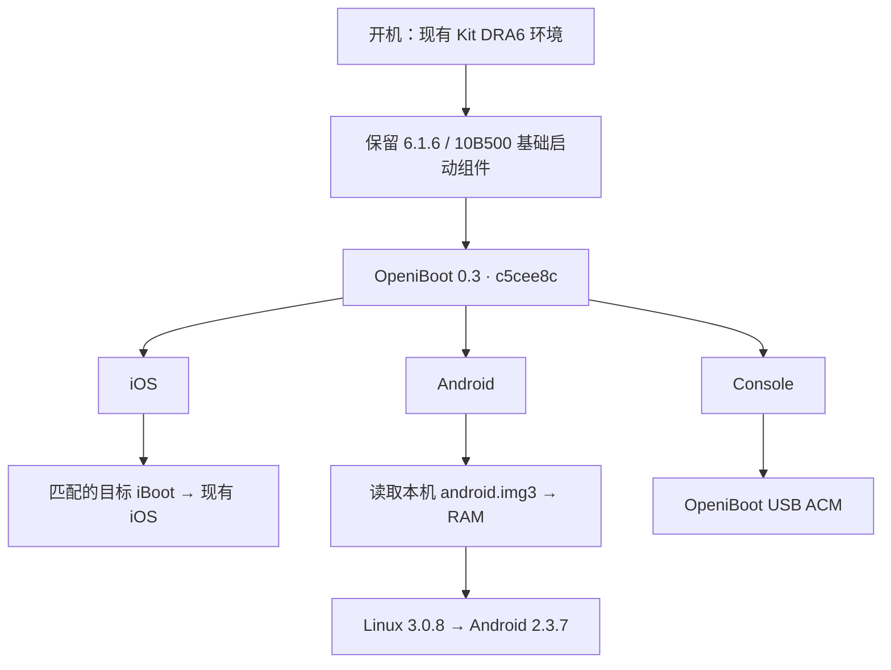

# touch4-idroid

**iPod touch 4G · OpeniBoot 三项菜单 · Android 2.3.7**

[](https://github.com/Peterdobby/touch4-idroid/actions/workflows/checks.yml)


在已有 Kit DRA6 / DRV6 引导环境的 iPod touch 4G 上，提供可拔线启动的 **iOS / Android / Console** 菜单。Android 已进入桌面，真实触摸、按键和 ADB shell 已得到实机验证。

公开仓库保存源码、构建脚本和说明。完整本机安装包、Apple 固件、签名票据、设备校准及原始备份保存在本地 `saved/`，不随 Git 提交。

## 已验证版本

| 主 iOS 系统 | 配置 | 实机结果 |
| --- | --- | --- |
| **iOS 5.1.1 / 9B206** | Installer **02.4** / MENU04 | 拔线菜单、iOS、Android、触摸和按键正常 |
| **iOS 7.1.2 / 11D257** | 原先验证的 **Kit 移植版** / MENU03 | 拔线菜单、iOS、Android、触摸和按键正常 |
| iOS 4.x / 6.x | 自动准备组件的流程已实现 | **尚未实机验证** |
| 其他 iOS 5 / 7 版本或其他硬件 | 未建立对应实机记录 | **不列为已支持** |

结果来自一台 **iPod4,1 / N81AP**，不能扩展为整个 iOS 5/7 系列或所有同型号设备均已验证。ADB shell 的实测记录属于本项目 Android RAM 构建；主机兼容范围尚未全面测试。

## 当前功能

- 拔掉电脑后重启，出现 iOS / Android / Console 三项菜单。
- 通过匹配的目标 iBoot 启动现有 iOS。
- 从本机启动文件进入 Linux 3.0.8 / Android 2.3.7 桌面。
- 真实触摸、Home 和音量键；Android 顶部诊断叠字已移除。
- OpeniBoot USB ACM 与 Android root ADB shell 已验证。

## RAM-only 的实际含义

| 层级 | 当前实现 | 重启后 |
| --- | --- | --- |
| 菜单与启动链 | 安装器持久更新启动镜像组 | 菜单保留，可拔线启动 |
| Android 启动文件 | `/boot/t4/android.img3` 保存于本机系统卷，启动时读取 | 启动文件保留 |
| Android 运行环境 | 内核和用户空间加载到 RAM | 下次启动重新加载 |
| Android 应用、设置和用户数据 | 当前运行环境中的 RAM 数据 | **重启丢失** |
| Android NAND 用户分区 | 尚未实现持久 userdata/cache | 暂无可长期保存的 Android 数据分区 |

安装器会写入启动固件和新增启动文件。Android 运行阶段仍使用 RAM 环境，现有 iOS 系统和用户文件保留。目前适合启动和交互实验，尚不适合作为日常 Android 系统。

Wi-Fi、音频、相机、蓝牙、完整电源管理、深度休眠及长期稳定性不列为已验证可用。详见 [当前状态](docs/STATUS.md) 和 [RAM 与存储](docs/RAM-AND-STORAGE.md)。

## 启动流程



**02.4 的关键修正：** 保留原成功版的六个 10B500 基础镜像，仅替换菜单 `ibob`。5.1.1 首轮混用目标版本 DeviceTree 后进入 DFU；恢复基础 DeviceTree 后，重启 USB/version、iOS 和拔线 Android 均得到确认。目标 iBoot 独立作为启动文件加载。“更新接口返回成功”和“冷启动成功”分别记录。

## 使用入口

需要 macOS、Python 3.9+、现有 Legacy iOS Kit，以及已进入并挂载系统卷的 SSH ramdisk。完整成功包带有本机身份校验，必须匹配自己的设备和构建。

持有本机保存的 `T4-Android-Installer-02.4.zip` 时：

```bash
python3 tools/import-installer.py /path/to/T4-Android-Installer-02.4.zip
bash start.sh
```

导入只做电脑端解包和校验。“检查”和“安装”分开执行，安装时显示实际 iOS 版本并要求确认。公开源码不附带可直接用于任意设备的完整固件包。

参见 [安装与已有成功包](docs/INSTALLING.md)、[构建与私有输入](docs/BUILDING.md)。

## 项目结构

```text
touch4-idroid/
├── start.sh                 # 命令行入口
├── docs/                    # 支持范围、存储限制、安装与开发说明
├── installer/               # 安装器源码与状态检查
├── chainload/               # RAM 交接、菜单与文件加载适配
├── linux-ramtest/           # Linux / Android / USB / 触摸源码及历史阶段
├── phase1/                  # 现有 DFU RAM 流程的主机工具
├── t4-menu/                 # OpeniBoot 菜单追踪与覆盖层
├── patches/                 # 上游源码修改
├── tools/                   # 打包、导入、检查和调试工具
└── saved/                   # 生成物、依赖、日志、固件与备份（Git 忽略）
```

日常入口是 `start.sh` 和当前安装器。诊断目录保留开发轨迹；历史 README 与“待验证”标记应结合 [当前状态](docs/STATUS.md) 阅读。冻结成功快照保持原样，新实验使用新的输出目录。

## 开发检查

以下检查不连接设备、不提交启动固件：

```bash
python3 installer/t4-android02/tests.py
python3 installer/t4-android02/test_profiles.py
python3 tools/test_native_image.py
bash -n start.sh installer/t4-android02/start.sh
```

02.4 通过 32 项安装状态测试、22 项组件与镜像组测试。实际冷启动、桌面和输入结果单独记录，主机测试不能替代实机验证。

## 来源与许可证

基于 [OpeniBoot](https://github.com/iDroid-Project/openiBoot)、[iDroid kernel](https://github.com/iDroid-Project/iDroid-kernel) 和现有 [Legacy iOS Kit](https://github.com/LukeZGD/Legacy-iOS-Kit) 工作流程。Android 用户空间实验复用了已有 androidi4 本地输入，该固件包和 Apple 固件未包含在公开源码中。

项目整合代码采用 GPL-3.0-or-later；Linux 衍生内容保留 GPL-2.0，第三方文件保留各自声明。参见 [上游与许可证](docs/THIRD-PARTY.md)。
