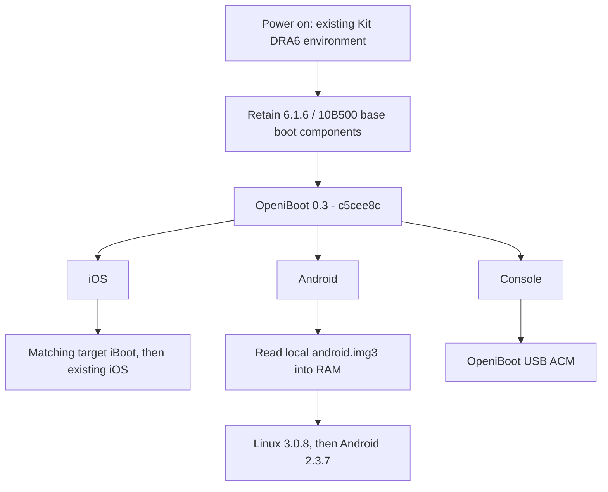

# touch4-idroid

**iPod touch 4G | OpeniBoot boot menu | Android 2.3.7**

[](https://github.com/Peterdobby/touch4-idroid/actions/workflows/checks.yml)


An experimental **iOS / Android / Console** boot menu for iPod touch 4G devices with an existing Kit DRA6 / DRV6 boot environment. The menu boots without a computer attached. Android reaches the desktop, with real touchscreen input, hardware buttons, and an ADB shell verified on hardware.

This repository contains source code, build scripts, and documentation. The Git source tree excludes firmware and private device inputs. The separate full release asset includes the verified owner device's firmware, signing material, and calibration; original backups remain local.

## Download the complete installer

[Download the full English installer ZIP](https://github.com/Peterdobby/touch4-idroid/releases/tag/v0.2.4-full-en). Extract it and run `bash start.sh`. It includes Android, boot images, the 5.1.1 profile, and macOS host tools. **This release is bound to the verified owner device and is not a universal installer.** It contains that device's identifier, calibration and signing material.

The repository's **Code > Download ZIP** contains source files only.

## Verified configurations

| Main iOS installation | Configuration | Hardware result |
| --- | --- | --- |
| **iOS 5.1.1 / 9B206** | Installer **02.4** / MENU04 | Unplugged boot menu, iOS, Android, touch, and buttons confirmed |
| **iOS 7.1.2 / 11D257** | Previously tested **Kit port** / MENU03 | Unplugged boot menu, iOS, Android, touch, and buttons confirmed |
| iOS 4.x / 6.x | Automatic component preparation implemented | **Not yet tested on hardware** |
| Other iOS 5 / 7 releases or other hardware | No matching hardware results | **Not listed as supported** |

These results come from one **iPod4,1 / N81AP**. They do not establish support for every iOS 5/7 release or every device of this model. ADB shell verification applies to this project's Android RAM build; host compatibility has not been comprehensively tested.

## Working features

- An iOS / Android / Console menu after rebooting with USB disconnected.
- The existing iOS installation boots through a matching target iBoot.
- Linux 3.0.8 / Android 2.3.7 reaches the desktop from locally stored boot files.
- Real touchscreen input, Home, and volume buttons; the Android diagnostic text overlay has been removed.
- OpeniBoot USB ACM and an Android root ADB shell.

## What RAM-only means

| Layer | Current implementation | After a reboot |
| --- | --- | --- |
| Menu and boot chain | The installer persistently updates the boot image set | Menu remains available without a computer |
| Android boot file | `/boot/t4/android.img3` is stored on the device's system volume and read during boot | Boot file remains |
| Android runtime | Kernel and userspace load into RAM | Reloaded on the next boot |
| Android apps, settings, and user data | Stored in the current RAM environment | **Changes are lost** |
| Android NAND data partition | Persistent userdata/cache has not been implemented | No persistent Android data partition |

The installer writes boot firmware and adds boot files. Android itself runs in RAM, while the existing iOS system and user files are retained. This is a boot and interaction experiment, not a daily-use Android system.

Wi-Fi, audio, camera, Bluetooth, complete power management, deep sleep, and long-term stability are not listed as verified features. See [Status](docs/STATUS.md) and [RAM and storage](docs/RAM-AND-STORAGE.md).

## Boot flow



**The 02.4 fix:** retain all six known-good 10B500 base images and replace only the menu `ibob`. The first 5.1.1 attempt mixed in the target DeviceTree and rebooted into DFU. Restoring the base DeviceTree produced confirmed OpeniBoot USB/version responses, iOS boot, and unplugged Android boot. The target iBoot is loaded separately as a boot file. An accepted firmware update and a successful cold boot are recorded as separate results.

## Getting started

The existing workflow requires macOS, Python 3.9+, Legacy iOS Kit, and an SSH ramdisk with the system volume mounted. Complete local packages contain device identity checks and must match your device and build.

If you already own the locally saved `T4-Android-Installer-02.4.zip`:

```bash
python3 tools/import-installer.py /path/to/T4-Android-Installer-02.4.zip
bash start.sh
```

Importing only unpacks and verifies the package on the host. Checking and installing are separate actions; installation displays the detected iOS version and requests confirmation. The public source repository does not include a complete firmware package for arbitrary devices. Existing installer prompts and historical diagnostic output remain in their original language.

See [Installation](docs/INSTALLING.md) and [Building and private inputs](docs/BUILDING.md).

## Repository layout

```text
touch4-idroid/
|-- start.sh                 # Command-line entry point
|-- docs/                    # Status, limitations, installation, and development
|-- installer/               # Installer source and state checks
|-- chainload/               # RAM handoff, menus, and file-loading adapters
|-- linux-ramtest/           # Linux, Android, USB, touch, and historical stages
|-- phase1/                  # Host tools for the existing DFU RAM workflow
|-- t4-menu/                 # OpeniBoot menu analysis and overlays
|-- patches/                 # Changes to upstream sources
|-- tools/                   # Packaging, import, verification, and diagnostics
`-- saved/                   # Outputs, dependencies, logs, firmware, and backups
```

Use `start.sh` and the current installer as the main entry points. Diagnostic directories preserve development history; read historical READMEs and unverified-stage notes alongside the [current status](docs/STATUS.md). Frozen successful snapshots are preserved unchanged. New experiments use new output directories.

## Development checks

These checks do not connect to a device or submit boot firmware:

```bash
python3 installer/t4-android02/tests.py
python3 installer/t4-android02/test_profiles.py
python3 tools/test_native_image.py
bash -n start.sh installer/t4-android02/start.sh
```

Installer 02.4 passed 32 installer-state tests and 22 component/image-set tests. Actual cold boot, desktop, and input results are recorded separately; host tests do not replace hardware validation.

## Upstream and licensing

Based on [OpeniBoot](https://github.com/iDroid-Project/openiBoot), the [iDroid kernel](https://github.com/iDroid-Project/iDroid-kernel), and existing [Legacy iOS Kit](https://github.com/LukeZGD/Legacy-iOS-Kit) workflows. Android userspace experiments reuse an existing local androidi4 input package. That package and Apple firmware are not included in this source release.

Project integration code is GPL-3.0-or-later. Linux-derived content retains GPL-2.0, and third-party files retain their own notices. See [Third-party components](docs/THIRD-PARTY.md).
